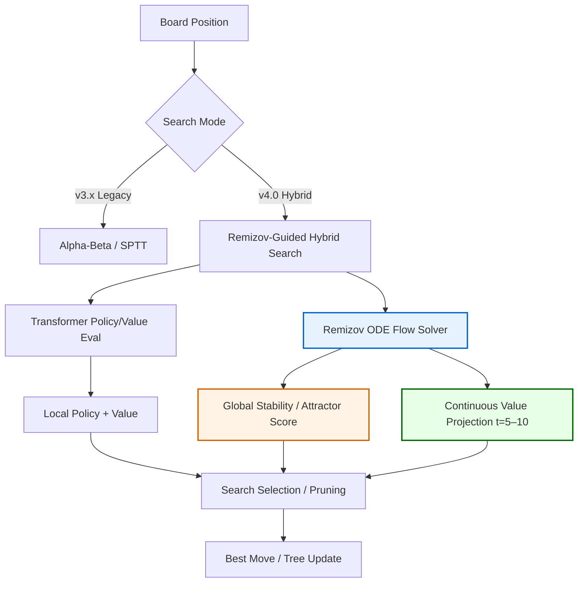

# NikolaChess Roadmap  
## v4.0 — NIKOLA 2.0 (Neural-Symbolic Engine with Continuous-Time Reasoning)

This document outlines the strategic and technical development plan for **NikolaChess** as it transitions from a high-performance NNUE engine into a **Neural-Symbolic chess engine** with **continuous-time evaluation dynamics** and analytic stability guarantees.

---

## 📍 Current Status

- **Current Stable**: v3.21.0  
- **Playing Strength**: ~3850 estimated Elo
- **Architecture**: NNUE + Alpha-Beta / SPTT Hybrid  
- **Language**: 100% MindLang  
- **Execution**: Deterministic, GPU-native

---

## 🎯 Vision & Motivation

Modern engines — whether alpha-beta based or neural MCTS (Lc0 / KataGo) — excel tactically but still struggle with **stability reasoning** in positions that are:

- Theoretically drawn but evaluated as winning  
- Fortress-like with no clear breakthrough  
- Long-horizon but shallow in search depth  

We call these **Neural Blind Spots**.

NikolaChess v4.0 addresses this fundamental gap by treating evaluation **as a continuous flow** over the game state, using **Remizov ODE solvers** as a **search primitive** — not just a heuristic addition.

Instead of asking *“What is the best move now?”*, Nikola asks:  
> **Where does this position converge?**  
> Is its evaluation an attractor, or a transient illusion?

This roadmap defines the technical path to that architecture.

---

## 🧠 Architecture Overview

*(Rendered using GitHub-native Mermaid support)*

**Flow Explanation**:
- **Transformer** → fast, local pattern intuition  
- **Remizov ODE Solver** → global stability & long-horizon projection  
- **Hybrid Search** → combines both signals for final decisions  

---

## 📐 Key Principles

1. **Continuous-Time Evaluation**  
   Evaluation drift modeled as a differential process — a flow field, not discrete snapshots.

2. **Analytic Attractor Detection**  
   Early identification of fortress/draw stability via ODE convergence criteria.

3. **Neural + Symbolic Harmony**  
   Transformer pattern recognition + Remizov analytic guarantees in one pipeline.

4. **Pragmatic Incrementality**  
   Phased rollout: rollout improvements → infrastructure → hybrid search → full training.

---

## 🛠 Strategic Phases

### Phase 0 — Maintenance & Stabilization
**Timeline**: Ongoing (v3.x LTS)
**Owner**: Core Team

Objectives:
- Long-term support for v3.x  
- Tournament bug fixes  
- WebGPU / multi-platform stabilization  

Deliverables:

| Subphase | Goals | Status |
|--------|------|--------|
| v3.21.x | Feedback fixes, NNUE refresh | In progress |
| v3.22.0 | Backend + time management | Planned |
| Toolchain | Port the public `.mind` sources to the current MIND compiler release and build them in CI; the compiler pin in `make setup` and the README moves from v0.1.9 to the release that CI built with, written from the CI run | Planned |
| Build | ARM64 / Windows improvements | Planned |

---

### Phase 1 — Remizov-Monte-Carlo
**Timeline**: Q1 → Q2 2026
**Owner**: Search + Math Team

Introduce continuous evaluation flow into rollouts.

Deliverables:
- **Remizov-MC Rollouts** — replace 20–50% random playouts with ODE trajectories (`remizov_feynman.mind`)
- **Variance Smoothing** — reduce oscillation in drawish regions
- **Analytic Contempt** — dynamic scaling via attractor strength

---

### Phase 1.5 — Core Infrastructure Refactor
**Timeline**: Q1 → Q2 2026
**Owner**: Core / Infra Team

Targets:

| Component | From | To |
|---------|------|----|
| Move Generation | Scattered | 100% vectorized Mind |
| Position Encoding | NNUE planes | 119-plane tensor |
| Hashing | Zobrist-64 | Zobrist-128 + neural |

Deliverables:
- `board.mind` full rewrite (~2× throughput)
- Tensor runtime consistency across all backends

---

### Phase 2 — Transformer Evaluator  
**Timeline**: Q2 2026  
**Owner**: Neural Team

Goals:
- 16-block Transformer (512 hidden dim)
- Convert ~5B v3.x positions to transformer-ready datasets
- Hybrid inference (Transformer + NNUE fallback)

**Target**: ≥3500 Elo standalone

---

### Phase 3 — Remizov-Guided Hybrid Search  
**Timeline**: Q2 → Q3 2026  
**Owner**: Search + Neural Team  

**This phase defines the core novelty.**

Deliverables:
- **Flow-Field Search** — evaluation treated as a dynamical system  
- **Attractor Pruning** — prune converging-to-draw subtrees analytically  
- **GPU Batching** — 4096+ positions/sec on consumer GPUs  

**Key Insight**  
Unlike standard MCTS (Lc0 / KataGo), decisions are driven by **analytic convergence** (Remizov ODE limits), not just visit counts or neural priors.

This enables **early analytic detection of fortresses and draw convergence**, even in positions where neural networks remain overconfident.

**Move Ordering — the √b Effective-Branching Law**

The single largest lever on search depth is move-ordering fidelity, not raw node throughput. Under the Knuth–Moore square-root law (1975), alpha-beta with *perfect* move ordering visits ≈ `b^(d/2)` nodes instead of `b^d` — the effective branching factor collapses from `b` to **√b**. For chess (b ≈ 35) that is `√35 ≈ 5.9`: the difference between reaching depth ~10 and depth 20+.

Near-√b ordering is realized through a priority pipeline:

- Hash / PV move first (transposition table)
- MVV-LVA for captures
- Killer moves + history heuristic for quiet moves
- Null-move pruning and Late Move Reductions to prune deeper

In the hybrid path, the **transformer policy head feeds move ordering directly** — a learned prior is the modern route to near-optimal ordering, and it compounds with the analytic pruning above. Ordering ties must resolve via a stable key so that games remain bit-level reproducible under MindLang determinism.

**Effective Branching Factor (EBF)** is tracked as a first-class search metric: target ≤ 7 before the policy head, ≤ 6 once the policy prior is online.

**Confidence-Weighted Re-Search — converging on the surviving move**

The Remizov flow asks *where a position converges*; the same convergence logic applies one level up, to *which move the search itself converges on*. Rather than spreading depth uniformly, re-search budget is concentrated on the candidate that keeps surviving refutation — the move whose evaluation stops moving as we look harder.

The statistical basis is the standard error of the value estimate: for a move re-examined `N` times (deeper re-searches, wider aspiration windows, additional rollouts), the uncertainty in its score shrinks as `~1/√N`. A move whose score holds steady across re-searches has a collapsing error bar; a move whose score swings is still noise. Selectivity should follow the error bar, not the raw best-score.

Concrete realizations on the current alpha-beta / SPTT path:

- **Aspiration-driven re-search budget** — the existing `aspiration_search` (narrow window around the prior draw-score) is wired into iterative deepening and given a per-move budget that grows for the surviving candidate and shrinks for moves that fail low. Today the deepening loop searches a full `[0,1]` window every iteration; the aspiration path already exists in `search.mind` but is unused — this closes that gap.
- **Singular-move extensions** — when one move's score is dramatically separated from the rest (a position on an ultra-thin path, where exactly one move holds the draw), extend search depth on that move alone. This is the classic singular-extension lever, and it is the search-level expression of "one move survives, everything else collapses."
- **Confidence as a pruning signal** — a candidate whose error bar has collapsed below threshold can terminate its own re-search early (its truth has stabilized), freeing budget for genuinely contested moves.

In the hybrid path this composes with the policy head and attractor pruning: the policy prior seeds *which* moves are worth re-searching, the `1/√N` confidence governs *how much* re-search each one earns, and the Remizov attractor score supplies the analytic stopping criterion. All re-search ordering and budget ties resolve via the same stable key as move ordering, preserving bit-level reproducibility under MindLang determinism.

**NikolaChess Immortal — thickest-branch selection toward the draw**

A variant configuration of the hybrid search tuned for maximum survivability rather than maximum sharpness. Where confidence-weighted re-search asks *which single move stops moving under scrutiny*, Immortal mode asks the dual question across the whole subtree: *which branch stays alive under the widest set of opponent replies*. Selection favors the **thickest** continuation — the move whose surviving sub-branches remain numerous and high-valued after refutation, not the one with the single sharpest line. A thin line that wins against best play but collapses against one inaccuracy is rejected in favor of a thick line that holds the draw against almost everything.

The search criterion combines two signals already present in the hybrid path:

- **Branch thickness** — for each candidate, measure the fraction (and aggregate value) of child sub-branches that survive above the draw threshold after deep re-search. A move ordering law promotes the candidate with the largest surviving mass, not just the largest single-line score. This is the subtree-level expression of robustness: many roads still reach the draw.
- **Persistent draw-direction bias** — the existing draw-first ordering and Remizov attractor score are kept as a standing pull toward the `1/2` fixed point across the whole game, so the engine continuously steers the position back toward the drawn attractor rather than only at the leaves. The draw is treated as the target basin, and Immortal mode keeps the position inside it.

Honest status: an earlier deep-network prototype was trained along exactly this thickest-branch / draw-steering principle. It was a *successful* design — the steering worked and the draw-survival behavior emerged — but competing engines still won their matches against it, so it is roadmapped here as an aspirational Immortal-mode variant, not a claim of parity. The open question carried forward is whether the analytic Remizov attractor (an explicit drawn fixed point) gives the thickness signal a sharper, more reproducible target than the learned prior alone did. Thickness scoring and all ordering ties resolve via the same stable key as the rest of the hybrid path, preserving bit-level reproducibility under MindLang determinism.

**Bootstrap protocol — backward induction from solved endgames toward the middlegame**

The engine already *consumes* retrograde-solved knowledge at the leaves: the Syzygy tablebase probe returns exact win/draw/loss verdicts for positions at or below the 7-piece boundary, and those tables are themselves built by backward induction from checkmate. The fast draw database is built to hold positions *beyond* that boundary across a certainty hierarchy (proven → tablebase → self-play → analysis → heuristic), but its higher tiers currently have no systematic producer. The bootstrap protocol is that producer.

The idea is to propagate proven results outward from the endgame edge rather than only evaluating inward from the root. Starting from the set of positions with an exact verdict, the protocol unmakes moves to enumerate predecessor positions one piece heavier, then resolves each predecessor by minimax over its successors — a position is proven won if any legal move reaches a proven win, proven drawn if its best move holds the drawn set, proven lost only if every move leads to a proven loss. Each newly-resolved position is written into the draw database keyed on its Zobrist hash, carrying its verdict, the distance back to the solved frontier, and the move that maintains it. Iterated, this pushes a frontier of exact knowledge from the endgame back through late- and mid-game positions, so that during a normal forward search a probe can return ground truth instead of a heuristic the moment the position is on the wrong side of that frontier.

This composes directly with the rest of Phase 3. The proven-draw positions become exact anchors for the Remizov `1/2` attractor, turning the draw-direction bias from a heuristic pull into a target seeded from ground truth, and they give Immortal-mode thickness scoring a hard floor — a branch backed by a bootstrapped draw entry is *known* to survive, not merely estimated to. Scope is bounded by the same combinatorics that bound tablebases: the predecessor graph grows steeply with piece count, so the protocol targets selected material configurations and reachable opening/middlegame structures rather than an exhaustive backward sweep, and entries carry their certainty tier so the search can weight a self-play-derived verdict differently from a proven one. Verdict resolution and all write-ordering ties resolve via the same stable key as the rest of the engine, so a bootstrapped database is bit-identical across substrates and reproducible under MindLang determinism.

**Self-consistency principle — the soundness invariant of the bootstrap database**

Backward induction is only correct if every stored verdict agrees with the minimax over its own successors. This is the database's governing invariant: a position labeled *won* must have at least one legal move into a stored *won*; a position labeled *drawn* must have a move into the drawn set and no move into a stored *won* for the side to move; a position labeled *lost* must have every move land in a stored *won* for the opponent. No entry may assert a verdict its children contradict. The Remizov `1/2` is exactly the fixed point of this relation — the draw is the value that maps to itself under optimal play, which is why it behaves as an attractor rather than a transient.

This gives the protocol a free correctness check and a maintenance rule. A self-consistency pass over the database is a closure operation: scan entries, recompute each verdict from its successors, and flag any that disagree. A clean pass certifies the frontier is internally coherent; a disagreement localizes either a generation bug or a position whose successor set was incomplete when it was written, and re-resolving it either confirms the verdict or propagates a correction outward to its predecessors until the database reaches a new fixed point. Because the check is pure minimax over stored verdicts with the same stable tie-key, the pass is itself deterministic and its result is bit-identical across substrates — so "the database is self-consistent" is a property the evidence chain can attest, not just an internal assumption.

---

### Phase 4 — Self-Play & Evolutionary Training  
**Timeline**: Q3 2026  
**Owner**: Training Team

Deliverables:
- Distributed self-play orchestration in MindLang
- **Inverse Remizov Regularization** — train networks to favor stable attractors
- Automated Elo benchmarking vs Stockfish, Lc0, Torch

**Target**: 4000+ Elo self-play

---

### Phase 5 — Symbolic Layer & Release  
**Timeline**: Q4 2026  
**Owner**: Release + Infra Teams

Deliverables:
- Fortress certification & symbolic proofs
- Universal binaries (Windows, Linux, macOS Metal, Android)
- Full technical whitepaper on Remizov-Guided Search

---

## 📈 Technical Performance Targets

| Metric | v3.21 (Current) | v4.0 (Target) |
|------|------------------|--------------|
| Elo (Consumer GPU) | ~3850 | 4000+ |
| Elo (Cluster) | ~3900 | 4200+ |
| Fortress Detection | Depth-reliant | Analytic / Immediate |
| Endgame Variance | High | Minimal (Smoothed) |
| Neural Blind Spot Reduction | ~10–20% | ≥40–60% |
| Effective Branching Factor (EBF) | ~9–11 | ≤6 (→ √b ≈ 5.9) |
| Language Runtime | MindLang v1 | MindLang v2-Native |

---

## 📝 Glossary

- **Remizov ODE Solver** — continuous-time framework modeling chess evaluation as a dynamical system  
- **Attractor** — stable convergence point (forced draw or fortress)  
- **Feynman–Kac Formula** — stochastic method used in Remizov-Monte-Carlo rollouts  
- **SPTT** — Speculative Parallel Tree Traversal, a hybrid search method combining alpha-beta with speculative parallel expansion
- **MindLang** — GPU-native, autodiff-enabled language for neural + symbolic systems
- **EBF (Effective Branching Factor)** — average number of child nodes actually searched per ply after pruning; the √b square-root law (Knuth–Moore) is its theoretical floor under perfect move ordering
- **√b Law** — with optimal alpha-beta move ordering, search cost drops from `b^d` to `b^(d/2)`, halving the effective exponent (b ≈ 35 → √b ≈ 5.9)

---

## 🤝 Contributing

We are actively seeking contributors with experience in:

- MindLang and GPU programming  
- Stochastic calculus / differential equations  
- Transformer optimization & large-scale training  

See the [Issues](https://github.com/star-ga/NikolaChess/issues) tab to get started.

---

**Repository**: https://github.com/star-ga/NikolaChess  
**Last Updated**: February 2026  
© 2026 **STARGA Inc.** All rights reserved.

<!-- NUMERIC-REVIEW-REVISION-20261029:BEGIN -->
## NNUE optimizer ablation (research)
- [ ] Verify the present `src/training.mind` Adam training path compiles and executes against the current toolchain, before calling it shipped.
- [ ] Compare pinned Adam baseline with SGD+momentum and AdamW on identical positions, splits, update counts and compute; report gradient/weight checks, held-out loss, actual match strength with confidence intervals and costs.
- [ ] Apply Cauchy–Schwarz/triangle only to well-defined numerical norm/error checks; use Chebyshev only when variance and sampling assumptions are explicit.
**Exit:** reproducible source/seed receipts and statistically defensible strength comparison. No BFGS/SQP/interior-point or PDE work by default.
<!-- NUMERIC-REVIEW-REVISION-20261029:END -->
